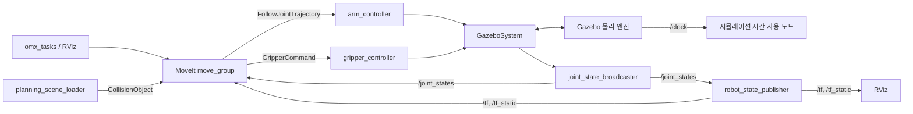

# OpenManipulator-X / ROS 2 Humble 프로젝트 설계

> 초기 설계 기록이다. 실제 구현·지원 모드·설치 방법·검증 상태는 루트 README.md를 기준으로 한다.

이 문서는 Gazebo 시뮬레이션과 MoveIt 2를 연결하기 위한 설계안이다.
아래는 구현 전 작성한 초기 설계다. 이후 패키지 구현, ROS/Gazebo/MoveIt 설치·빌드와
OMX-F의 6개 통합 검사를 완료했다. 최신 구성과 검증 범위는 README.md 및 verification.md를 참조한다.

## 1. 기준 환경과 의존성

| 항목 | 기준 |
| --- | --- |
| 운영체제 | Ubuntu 22.04 |
| ROS | ROS 2 Humble |
| 계획/시각화 | Humble용 MoveIt 2, OMPL, RViz 2 |
| 제어 | ros2_control, ros2_controllers |
| 최초 시뮬레이션 | Gazebo Classic 11, gazebo_ros_pkgs, gazebo_ros2_control |
| 로봇 모델 | ROBOTIS `open_manipulator`의 `humble` 브랜치 |
| 작업 노드 | C++ / rclcpp / MoveGroupInterface |

**공식 Humble 패키지 재사용을 우선하는 구성이다.** 확인한 공식 모델은
`gazebo_ros2_control/GazeboSystem`과 `libgazebo_ros2_control.so`를 사용한다.
Gazebo Classic은 2025년 1월 지원이 종료되었으므로 재현 환경을 고정한다.
Modern Gazebo를 사용하려면 Humble과 권장 조합인 Fortress를 별도 백엔드로 구현한다.
이 경우 spawn, ros2_control 플러그인, 월드 및 clock/센서 브리지를 교체해야 한다.
Classic용 플러그인과 Modern Gazebo용 플러그인을 섞지 않는다.

확인한 공식 소스 커밋: `84b68b219a0fa30b223ad7e3c268d1f11fa43577`.
`dependencies.repos`에는 브랜치 대신 검증한 커밋을 기록한다. 실기 연동에 필요한
DYNAMIXEL 의존성이 rosdep으로 해소되지 않으면 해당 소스도 버전 고정해 추가한다.

## 2. 워크스페이스 구조

아래 구조는 앞으로 생성할 구조다. 각 ROS 패키지에는 `package.xml`과
`CMakeLists.txt`를 두고 launch/config/urdf/worlds 등의 리소스를 설치한다.

```text
omx_ws/
├── README.md
├── dependencies.repos
├── docs/
│   ├── architecture.md
│   └── verification.md
├── src/
│   ├── vendor/
│   │   └── open_manipulator/              # 공식 소스, 커밋 고정
│   │       ├── open_manipulator_x_description/
│   │       ├── open_manipulator_x_bringup/
│   │       ├── open_manipulator_x_moveit_config/
│   │       └── ...                       # 공식 GUI/teleop 등은 필요 시 사용
│   └── omx_project/
│       ├── omx_description/              # 프로젝트 조립 모델
│       │   ├── urdf/omx_cell.urdf.xacro
│       │   └── config/initial_positions.yaml
│       ├── omx_control/                  # 제어 설정 소유, 노드 직접 기동 안 함
│       │   └── config/
│       │       ├── controllers_sim.yaml
│       │       └── controllers_hardware.yaml
│       ├── omx_simulation/               # 시뮬레이터와 로봇 spawn
│       │   ├── launch/gazebo_classic.launch.py
│       │   ├── worlds/workcell.world
│       │   └── models/
│       ├── omx_moveit_config/            # 프로젝트용 MoveIt 설정
│       │   ├── config/
│       │   │   ├── omx.srdf
│       │   │   ├── kinematics.yaml
│       │   │   ├── joint_limits.yaml
│       │   │   ├── ompl_planning.yaml
│       │   │   ├── moveit_controllers.yaml
│       │   │   └── moveit.rviz
│       │   └── launch/move_group.launch.py
│       ├── omx_bringup/                  # 전체 구성과 시작 순서의 소유자
│       │   ├── launch/
│       │   │   ├── bringup.launch.py
│       │   │   ├── simulation.launch.py
│       │   │   ├── fake.launch.py
│       │   │   └── hardware.launch.py
│       │   └── scripts/wait_for_system.py
│       └── omx_tasks/                    # 로봇 작업 로직
│           ├── include/omx_tasks/
│           ├── src/
│           │   ├── named_target_demo.cpp
│           │   └── planning_scene_loader.cpp
│           ├── config/workcell_objects.yaml
│           └── launch/demo.launch.py
├── build/                                # 생성물, 버전 관리 제외
├── install/                              # 생성물, 버전 관리 제외
└── log/                                  # 생성물, 버전 관리 제외
```

`vendor`는 ROS 패키지가 아닌 정리용 디렉터리다. 공식 패키지와 프로젝트 패키지의
이름을 다르게 두어 colcon의 패키지 중복을 피한다.
초기 통합 확인에는 공식 description/bringup/MoveIt 설정을 그대로 사용한다.
작업대나 센서를 추가할 때 프로젝트 패키지로 확장하며 공식 패키지 내부를 직접 수정하지 않는다.

## 3. 패키지 경계와 설정 소유권

| 패키지 | 책임 | 주요 의존성 |
| --- | --- | --- |
| `omx_description` | 공식 Xacro 매크로로 팔 조립, 고정 베이스와 센서 TF, backend에 따른 제어 플러그인 선택 | 공식 description, xacro |
| `omx_control` | 관절과 제어 인터페이스, sim/hardware별 컨트롤러 설정 | controller_manager, joint_state_broadcaster, joint_trajectory_controller, gripper_controllers |
| `omx_simulation` | Gazebo 실행, 월드 로딩, 동일 모델 spawn | gazebo_ros, gazebo_ros2_control |
| `omx_moveit_config` | SRDF, IK, 계획기, 관절 제한, 실행 액션 매핑 | moveit_ros_move_group, moveit_planners_ompl, moveit_simple_controller_manager |
| `omx_bringup` | 공통 모델 생성, backend 선택, 상태 발행기·spawner·MoveIt·RViz 조립 | 위 패키지, launch_ros, robot_state_publisher |
| `omx_tasks` | 목표 요청, 계획 및 실행 결과 처리, 장애물 등록 | rclcpp, moveit_ros_planning_interface |

공식 최상위 `open_manipulator_x_robot.urdf.xacro`는 제어 설정 경로를 공식 bringup으로
지정하고 있으므로, 자체 `controllers_sim.yaml` 파일을 만드는 것만으로 설정이 바뀌지 않는다.
프로젝트 조립 모델에서는 공식 기구학/외형 매크로를 재사용하고 Gazebo 플러그인의
`<parameters>`가 프로젝트의 제어 설정을 가리키도록 명시적으로 구성한다.

bringup이 backend 인자를 반영해 모델을 생성하고, robot_state_publisher, Gazebo spawn,
move_group, RViz, 필요한 작업 노드에 일관된 `robot_description`을 전달한다.
SRDF와 관절 제한도 한 설정 원본을 공유한다. 각 launch에서 서로 다른 기본값으로 모델을
다시 생성하지 않는다. 경로는 ament package share에서 구한다.

## 4. 런타임 데이터 흐름



시뮬레이션에서는 Gazebo 플러그인이 controller_manager를 생성한다.
별도 `ros2_control_node`를 추가로 띄우지 않는다. fake/hardware 모드에서는
별도 `ros2_control_node` 하나가 controller_manager를 소유한다.
MoveItSimpleControllerManager는 실행 액션을 연결하는 MoveIt 플러그인이며,
ros2_control의 controller_manager와 역할이 다르다.

## 5. 이름과 인터페이스 규약

단일 로봇, 빈 namespace 및 prefix로 시작한다. 아래 이름은 확인한 공식 Humble 설정과 맞춘다.

| 대상 | 이름/인터페이스 |
| --- | --- |
| MoveIt 팔 그룹 | `arm` |
| 팔 구동 관절 | `joint1`, `joint2`, `joint3`, `joint4` |
| MoveIt 그리퍼 그룹 | `gripper` |
| 그리퍼 구동 관절 | `gripper_left_joint` |
| 그리퍼 종속 관절 | `gripper_right_joint`, mimic/passive 처리 |
| 끝단 링크 | `end_effector_link` |
| 계획 기준 프레임 | `world`, 고정 연결로 `link1`에 연결 |
| 팔 실행 액션 | `/arm_controller/follow_joint_trajectory` (`control_msgs/action/FollowJointTrajectory`) |
| 그리퍼 실행 액션 | `/gripper_controller/gripper_cmd` (`control_msgs/action/GripperCommand`) |
| 상태/시간 | `/joint_states`, `/tf`, `/tf_static`, `/clock` |

팔의 command interface는 `position`, state interface는 `position`, `velocity`를 기준으로 한다.
그리퍼는 position용 GripperActionController로 구동하고 우측 관절을 독립 목표로 보내지 않는다.
URDF의 mimic 정의와 시뮬레이터 제어 계층의 mimic/multiplier 설정을 함께 유지한다.
그리퍼 command는 URDF 구동 관절 좌표이며 손가락 사이 전체 간격과의 변환은 작업 API에서 명시한다.

`controllers_sim.yaml`은 실제 ros2_control 컨트롤러를 정의하고,
`moveit_controllers.yaml`은 MoveIt이 호출할 액션을 매핑한다. 두 파일은 목적이 다르다.
MoveIt 실행 매핑의 핵심은 다음과 같다. 이 내용을 move_group 파라미터로 로드한다.

```yaml
moveit_controller_manager: moveit_simple_controller_manager/MoveItSimpleControllerManager
moveit_simple_controller_manager:
  controller_names: [arm_controller, gripper_controller]
  arm_controller:
    type: FollowJointTrajectory
    action_ns: follow_joint_trajectory
    default: true
    joints: [joint1, joint2, joint3, joint4]
  gripper_controller:
    type: GripperCommand
    action_ns: gripper_cmd
    default: true
    joints: [gripper_left_joint]
```

관절 이름, limit, controller 이름, action namespace를 URDF/SRDF/두 제어 설정에서 일치시킨다.
MoveIt 제한은 URDF/구동계 제한보다 느슨하게 설정하지 않는다.
다중 로봇은 후속 확장으로 두며, namespace 도입 시 서비스·액션 경로와 TF prefix,
SRDF 및 관절 목록을 함께 치환한다.

## 6. 실행 순서와 launch 계약

프로젝트 최상위 `bringup.launch.py`에 아래 인자를 제공한다.
아래는 프로젝트에서 구현할 API이며 공식 launch 인자와 동일하다는 의미는 아니다.

| 인자 | 기본값/동작 |
| --- | --- |
| `backend` | `gazebo_classic`; 이후 `fake`, `hardware` 지원 |
| `world` | `omx_simulation/worlds/workcell.world` |
| `rviz` | `true` |
| `start_tasks` | `false`; 사용자가 작업 실행을 선택 |
| `port_name` | hardware 모드에서만 적용 |
| `use_sim_time` | backend에서 결정: Gazebo는 true, fake/hardware는 false |

시뮬레이션 실행 순서:

1. Xacro 처리 후 robot_state_publisher와 Gazebo 서버 시작.
2. Gazebo spawn 서비스 준비를 기다려 로봇 생성. 생성 실패 시 후속 단계 중단.
3. `/controller_manager` 서비스 준비를 기다려 `joint_state_broadcaster` 활성화.
4. `arm_controller`, `gripper_controller` 활성화 및 상태 확인.
5. 진행하는 `/clock`, 최신 `/joint_states`, 필요한 TF와 실행 액션의 준비 확인.
6. move_group과 RViz 시작. 요청된 경우 작업 노드 시작.

spawner의 timeout과 실패 종료 코드를 처리하고 준비 확인 실패 시 명확하게 종료한다.
프로세스 종료 이벤트만으로 성공을 간주하지 않는다. 고정 sleep으로 시작 순서를 맞추지 않는다.
물리 엔진이 paused 상태이면 제어 활성화/clock 진행이 막힐 수 있어 unpaused 시작을 기본으로 한다.
MoveIt, RViz, robot_state_publisher, controller_manager와 시간에 의존하는 작업 노드에
`use_sim_time=true`를 적용한다. 실제 상태 발행 중에는 joint_state_publisher를 추가 실행하지 않는다.

## 7. 작업 계획과 충돌 환경

OpenManipulator-X의 팔은 4개 구동 관절을 가지므로 임의의 6D 위치·자세 목표를 모두 만족할 수 없다.
첫 데모는 공식 named target `home`/`init`와 joint-space 목표로 검증한다.
그다음 작업에 맞는 위치 목표와 제한된 자세 조건을 추가한다.
공식 IK 설정을 출발점으로 삼되 위치 전용 옵션의 실제 solver 지원과 도달 가능성은 실행 검증한다.
계획 실패, IK 실패, 실행 실패를 구분하고 실패한 계획을 실행하지 않는다.

Gazebo의 테이블과 물체가 MoveIt PlanningScene에 자동 등록되지는 않는다.
`planning_scene_loader`가 `workcell_objects.yaml`을 읽어 동일한 크기와 world 좌표의
CollisionObject를 등록하고 적용 완료를 확인한다. Gazebo 배치도 같은 원본에서 생성해 불일치를 피한다.
집기 기능을 확장할 때는 MoveIt의 attached object 상태와 Gazebo의 실제 물체 구속/접촉 동작을 별도로 연결한다.

## 8. 개발 및 검증 단계

1. **공식 기준 확인:** 의존성 설치·빌드 후 아래 공식 통합 launch로 RViz와 Gazebo 동작을 확인한다.
2. **프로젝트 실행 통합:** 공통 모델, 시간 설정, 준비 대기 로직을 포함한 자체 bringup을 구현한다.
3. **작업 환경 확장:** 작업대/장애물과 PlanningScene을 일치시키고 named target 데모를 구현한다.
4. **작업 로직 확장:** 도달 가능한 목표 생성, 실행 취소/실패 처리, 그리퍼 작업을 추가한다.
5. **실기 전환:** 동일한 계획/실행 인터페이스를 유지하며 hardware 플러그인·설정과 시간 소스를 전환한다.

공식 Humble 기준 launch 명령(의존성 설치·빌드 및 overlay source 후 사용):

```bash
ros2 launch open_manipulator_x_moveit_config moveit_gazebo.launch.py
```

이 launch는 Gazebo bringup도 포함한다. 별도 Gazebo launch를 동시에 실행하지 않는다.
프로젝트 패키지 구현 후의 목표 실행 명령은 다음과 같다.

```bash
ros2 launch omx_bringup bringup.launch.py backend:=gazebo_classic rviz:=true
```

통합 완료 판정:

- `ros2 control list_controllers`에서 broadcaster와 두 컨트롤러가 active이다.
- `ros2 action list -t`에서 팔/그리퍼 실행 액션과 타입이 규약에 맞는다.
- `/joint_states`의 구동 관절 상태가 최신이며 `world`부터 끝단까지 TF가 연결된다.
- RViz에서 `home` → `init`를 Plan & Execute 하면 Gazebo 관절이 움직이고 최종 상태가 허용 오차 안에 든다.
- 그리퍼 open/close에서 양쪽 손가락의 종속 동작이 맞는다.
- PlanningScene에 등록한 장애물과 충돌하는 목표를 거부하거나 회피 경로를 만든다.
- 종료 후 재실행해도 중복 controller_manager, 상태 발행자, 로봇 entity가 남지 않는다.

CI는 Humble 환경에서 rosdep 의존성 해소와 colcon build를 먼저 수행한다.
통합 코드 작성 후 headless Gazebo에서 위 준비 상태 및 실제 목표 실행을 검증한다.
문서 작성 단계인 현재는 런타임 검증을 수행하지 않았다.

## 9. 제공된 손 추적 코드 반영

사용자가 제공한 `hand_control_node.py`와 `robot_bridge_node.py`를 기준으로 한 확장 설계다.
이 절은 코드 검토와 통합 설계이며 두 노드의 수정 구현은 아직 수행하지 않았다.

### 현재 동작

```text
웹캠 → MediaPipe → hand_control_node (목표 발행 주기 30 Hz)
                    ├─ /hand_robot_pose : PoseStamped, frame_id=link1
                    └─ /hand_gripper    : String, GRASP / RELEASE
                                   ↓
                           robot_bridge_node
                    ├─ 자체 해석 IK → /arm_controller/joint_trajectory
                    └─ GripperCommand → /gripper_controller/gripper_cmd
```

손 제어 노드는 왼손의 화면 위치와 영상 내 손 크기를 속도 입력처럼 사용해 목표 위치를 누적한다.
깊이 카메라로 손의 절대 3D 좌표를 측정하는 방식은 아니다.
브리지는 위치만 받아 여러 pitch 중 첫 번째 유효 해를 선택하고 0.15초짜리 궤적을 발행한다.
따라서 현재 팔 명령 경로에는 MoveIt의 계획이나 충돌 검사가 포함되지 않는다.
MoveIt을 별도로 실행해 로봇을 표시해도 이 직접 명령에 MoveIt 검사가 자동 적용되지는 않는다.

### 추가할 패키지

```text
omx_project/
├── omx_hand_input/                 # ament_python
│   ├── omx_hand_input/hand_control_node.py
│   ├── config/hand_control.yaml
│   └── launch/hand_input.launch.py
└── omx_teleop/                     # ament_python
    ├── omx_teleop/
    │   ├── robot_bridge_node.py    # 기존 직접 IK 모드
    │   ├── analytic_ik.py          # ROS와 분리한 IK/FK 검증 단위
    │   └── servo_input_node.py    # 추후 MoveIt Servo 입력 어댑터
    ├── config/teleop.yaml
    └── launch/teleop.launch.py
```

Python 패키지는 `package.xml`, `setup.py`, `setup.cfg`, resource marker를 사용한다.
기존 작업용 C++ 패키지와 달리 CMakeLists.txt를 필수로 두지 않는다.
OpenCV/MediaPipe 의존성은 입력 패키지에 한정한다. `sounddevice`를 MagicMock으로 바꾸는
전역 우회 코드는 재현 가능한 의존성 해결책으로 취급하지 않고 버전 고정/환경 분리로 대체한다.

### 제어 모드

| 모드 | 팔 명령 경로 | 용도 |
| --- | --- | --- |
| `direct_ik` | 기존 브리지 → JointTrajectoryController | 기존 동작의 시뮬레이션 재현과 IK 검증 |
| `planned` | 확정한 손 목표 → omx_tasks → MoveIt 계획·실행 | 목표 지점으로 이동, 충돌 회피 경로 검증 |
| `servo` | 손 입력 어댑터 → MoveIt Servo → JointTrajectoryController | 연속 손 추종 |

`planned`는 30 Hz 입력마다 새 plan/execute를 시작하지 않는다. 최신 목표를 보관하고
목표 확정 이벤트나 명시적인 작업 상태 전환에서 실행한다. 동시 계획·실행은 하나로 제한하고
새 요청의 취소/교체 정책을 정한다.

`servo`는 Humble의 TwistStamped/JointJog 입력을 사용한다. 현재 PoseStamped를 그대로
Servo에 연결하지 않는다. 초기에는 현재 관절 상태와 기존 IK에서 제한된 joint velocity를
만드는 JointJog 어댑터로 검증할 수 있다. Cartesian 제어는 4축의 가능한 작업 방향,
자세 자유도, 특이점 처리를 확인한 뒤 적용한다. Servo 충돌 검사는 설정한 PlanningScene에
기반한 감속/정지 기능이며 장애물을 우회하는 전역 경로 계획과 구분한다.

팔에 명령을 쓰는 direct IK, Servo, MoveIt 실행은 한 시점에 하나만 활성화한다.
모드 전환 시 이전 경로의 명령 발행과 진행 중 실행을 중단한 뒤 새 경로를 활성화한다.
RViz의 Execute도 같은 정책에 포함한다. 그리퍼는 독립 경로로 유지할 수 있다.

### 구현 전에 반영할 사항

| 현재 코드에서 확인한 동작 | 수정 방향 |
| --- | --- |
| 손을 잃어도 마지막 pose와 그리퍼 상태를 계속 발행 | 추적 유효성/enable을 별도 전달하고 비활성 시 새 동작 금지 및 모드별 정지 수행 |
| 카메라 read 실패 시 callback이 바로 반환 | 수신 측 watchdog으로 입력 중단 감지. 계속 오는 오래된 목표와 추적 실패도 별도 구분 |
| 브리지에서 header.frame_id와 stamp 무시 | `link1` 좌표만 허용하거나 TF 변환, 오래된 입력 거부 |
| PoseStamped의 quaternion이 기본값 (0,0,0,0) | 위치 전용 계약이면 PointStamped로 명확화. Pose 유지 시 유효 quaternion과 자세 처리 정책 정의 |
| 30 Hz마다 0.15초 궤적 새로 발행 | 컨트롤러 목표의 연속 교체를 고려해 관절 피드백, 속도·가속도 제한, 명령 주기 검증 |
| pitch 후보 중 첫 해 선택, 실제 관절 상태 미사용 | 직전/현재 관절에 가까운 유효 해 선택, URDF 기반 FK로 IK 해 검증 |
| x/y/z별 범위만 제한 | 상자 안의 모든 점이 도달 가능한 것은 아니므로 IK·관절 한계·충돌 검사를 별도로 수행 |
| 프레임마다 최대 0.005 m 누적 | 속도(m/s) × 경과 시간으로 변경하고 과도한 dt를 제한. 시작/재연결 시 현재 끝단 위치로 목표 동기화 |
| GRASP 외 모든 문자열을 열기 명령으로 처리 | GRASP/RELEASE만 허용하고 나머지는 거부 |
| 그리퍼 전송 전에 last_gripper 갱신 | goal 수락과 결과를 확인하고 성공 상태/요청 상태를 구분해 실패 시 재시도 가능하게 구성 |

현재의 손 유실 처리는 목표 누적만 멈춘다. 이미 전송된 궤적이나 그리퍼 동작의 중단을
보장하지 않으므로 화면의 `SAFETY STOP`과 실제 제어 상태를 동일시하지 않는다.
별도 enable과 입력 유효성, 상태 피드백을 연결한 뒤 실제 동작을 검증한다.

검증 순서는 기존 direct IK로 Gazebo 동작 재현 → 정지/입력 유효성/피드백 보완 →
확정 목표의 MoveIt 계획 실행 → Servo 연속 제어 적용으로 잡는다.
이 절의 모든 제어 모드는 설계 단계이며 아직 실행 검증하지 않았다.

## 참고 자료

- [ROBOTIS 공식 Humble 소스](https://github.com/ROBOTIS-GIT/open_manipulator/tree/84b68b219a0fa30b223ad7e3c268d1f11fa43577)
- [공식 통합 launch](https://github.com/ROBOTIS-GIT/open_manipulator/blob/84b68b219a0fa30b223ad7e3c268d1f11fa43577/open_manipulator_x_moveit_config/launch/moveit_gazebo.launch.py)
- [공식 Gazebo 제어 설정](https://github.com/ROBOTIS-GIT/open_manipulator/blob/84b68b219a0fa30b223ad7e3c268d1f11fa43577/open_manipulator_x_bringup/config/gazebo_controller_manager.yaml)
- [공식 MoveIt 액션 매핑](https://github.com/ROBOTIS-GIT/open_manipulator/blob/84b68b219a0fa30b223ad7e3c268d1f11fa43577/open_manipulator_x_moveit_config/config/moveit_controllers.yaml)
- [공식 SRDF](https://github.com/ROBOTIS-GIT/open_manipulator/blob/84b68b219a0fa30b223ad7e3c268d1f11fa43577/open_manipulator_x_moveit_config/config/open_manipulator_x.srdf)
- [Humble gazebo_ros2_control 및 Classic 지원 종료](https://control.ros.org/humble/doc/gazebo_ros2_control/doc/index.html)
- [Humble MoveIt 컨트롤러 연동](https://moveit.picknik.ai/humble/doc/examples/controller_configuration/controller_configuration_tutorial.html)
- [Humble MoveIt Servo 입력과 설정](https://moveit.picknik.ai/humble/doc/examples/realtime_servo/realtime_servo_tutorial.html)
- [ROS/Gazebo 버전 조합](https://gazebosim.org/docs/fortress/ros_installation/)
